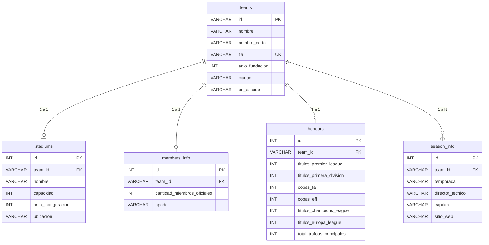

# Premier League API — Temporada 2026/2027

REST API construida con **Node.js**, **Express** y **MySQL** que proporciona información completa, estructurada y actualizada sobre los 20 equipos participantes de la **Premier League inglesa** en la temporada **2026/2027**.

Incluye persistencia relacional con **MySQL / MariaDB** (compatible con **XAMPP**), consultas SQL optimizadas con `JOIN`, búsqueda de texto, filtros avanzados, ordenación multidimensional, paginación configurable y endpoints de estadísticas agregadas sobre estadios, palmarés y distribución geográfica.

---

## Tabla de Contenidos

- [Características Principales](#características-principales)
- [Requisitos e Instalación](#requisitos-e-instalación)
- [Ejecución y Base de Datos (XAMPP / MySQL)](#ejecución-y-base-de-datos-xampp--mysql)
- [Base de Datos y Modelo Relacional (MySQL)](#base-de-datos-y-modelo-relacional-mysql)
  - [Diagrama Entidad-Relación (ERD)](#diagrama-entidad-relación-erd)
  - [Descripción de Tablas y Esquema DDL](#descripción-de-tablas-y-esquema-ddl)
  - [Integridad Referencial e Índices](#integridad-referencial-e-índices)
  - [Prevención de Inyecciones SQL](#prevención-de-inyecciones-sql)
- [Estructura del Proyecto](#estructura-del-proyecto)
- [Modelo de Datos](#modelo-de-datos)
- [Referencia de Endpoints](#referencia-de-endpoints)
  - [1. Raíz / Información General](#1-raíz--información-general)
  - [2. Listado de Equipos](#2-listado-de-equipos)
  - [3. Detalle de Equipo](#3-detalle-de-equipo)
  - [4. Estadio de un Equipo](#4-estadio-de-un-equipo)
  - [5. Palmarés de un Equipo](#5-palmarés-de-un-equipo)
  - [6. Info de Temporada Actual](#6-info-de-temporada-actual)
  - [7. Resumen Global de la Liga](#7-resumen-global-de-la-liga)
  - [8. Equipos Agrupados por Ciudad](#8-equipos-agrupados-por-ciudad)
  - [9. Ranking de Trofeos](#9-ranking-de-trofeos)
  - [10. Ranking de Estadios](#10-ranking-de-estadios)
- [Parámetros de Consulta (Query Params)](#parámetros-de-consulta-query-params)
- [Manejo de Errores](#manejo-de-errores)
- [Clubes de la Temporada 2026/27](#clubes-de-la-temporada-202627)
- [Licencia](#licencia)

---

## Características Principales

* **Persistencia Relacional en MySQL**: Integración completa con MySQL / MariaDB mediante `mysql2/promise` con Connection Pooling para alta concurrencia.
* **Auto-inicialización y Siembra (Seed)**: Creación automática de base de datos, tablas relacionales con restricciones y carga de datos iniciales en el primer inicio.
* **20 clubes actualizados**: Plantel de la temporada 2026/2027 con directores técnicos, capitanes y sitios web oficiales.
* **Estadios modernos**: Infraestructura al día, incluyendo el nuevo **Everton Stadium** en Bramley-Moore Dock y las ampliaciones de **Etihad Stadium** y **Craven Cottage**.
* **Búsqueda y filtros SQL dinámicos**: Consultas relacionales `LEFT JOIN` con búsqueda por término en nombre, ciudad y apodo, con filtros por ciudad, año de fundación, DT, existencia de trofeos y temporada.
* **Ordenación y paginación en base de datos**: Cláusulas `ORDER BY` y `LIMIT / OFFSET` calculadas a nivel motor de base de datos con metadatos de paginación (`total`, `pagina`, `limite`, `total_paginas`).
* **Estadísticas agregadas de liga**: Funciones de agregación SQL (`COUNT`, `SUM`, `AVG`, `COALESCE`) para resúmenes de liga, rankings de títulos, aforos y distribución geográfica.
* **CORS y Logging**: Middleware de CORS habilitado para consumo frontend y logging de solicitudes HTTP mediante Morgan.

---

## Requisitos e Instalación

### Requisitos previos
- [Node.js](https://nodejs.org/) (versión 18.0.0 o superior recomendada)
- [npm](https://www.npmjs.com/) (incluido con Node.js)
- [XAMPP](https://www.apachefriends.org/) con el módulo **MySQL** iniciado (puerto 3306 por defecto)

### Instalación

1. Clona o descarga el repositorio en tu equipo.
2. Abre el **XAMPP Control Panel** e inicia el servicio **MySQL**.
3. Abre una terminal en la carpeta raíz del proyecto y ejecuta:

```bash
npm install
```

Esto instalará las dependencias necesarias:
* `express`: Framework web ligero y flexible.
* `mysql2`: Cliente de alto rendimiento para MySQL/MariaDB con soporte de Promises y Pool de conexiones.
* `dotenv`: Carga de variables de entorno desde el archivo `.env`.
* `cors`: Middleware para permitir solicitudes de origen cruzado (Cross-Origin Resource Sharing).
* `morgan`: Logger de solicitudes HTTP en consola para desarrollo.

---

## Ejecución y Base de Datos (XAMPP / MySQL)

### Variables de Entorno (`.env`)
El proyecto incluye un archivo `.env` configurado por defecto para XAMPP:
```ini
PORT=3000
DB_HOST=localhost
DB_PORT=3306
DB_USER=root
DB_PASSWORD=
DB_NAME=premier_league
```

### Inicialización y Siembra de Datos
Al iniciar la aplicación con `npm start` o `npm run dev`, el servidor se conecta a MySQL en XAMPP y:
1. Crea automáticamente la base de datos `premier_league` si no existe.
2. Crea las tablas relacionales (`teams`, `stadiums`, `members_info`, `honours`, `season_info`).
3. Si la base de datos está vacía, puebla automáticamente los 20 clubes desde `data/teams.json`.

También puedes ejecutar la siembra manualmente en cualquier momento:
```bash
npm run seed
```

> **Nota para phpMyAdmin:** Si prefieres ver o importar la estructura SQL directamente desde el navegador, puedes ingresar a `http://localhost/phpmyadmin` o consultar el script listo en `src/database/schema.sql`.

### Modo Producción
Inicia el servidor en el entorno estándar:

```bash
npm start
```

### Modo Desarrollo
Inicia el servidor con reinicio automático ante cambios en el código (`node --watch`):

```bash
npm run dev
```

El servidor iniciará por defecto en `http://localhost:3000`. Puedes personalizar el puerto definiendo la variable de entorno `PORT`:

```bash
# Ejemplo en PowerShell
$env:PORT=4000; npm start

# Ejemplo en Bash / Linux / macOS
PORT=4000 npm start
```

---

## Base de Datos y Modelo Relacional (MySQL)

La aplicación utiliza **MySQL / MariaDB** (mediante el paquete `mysql2/promise`) como motor de base de datos relacional. La estructura está normalizada en 5 tablas vinculadas mediante claves foráneas con eliminación en cascada (`ON DELETE CASCADE`), asegurando integridad referencial, consistencia transaccional y alto desempeño con índices dedicados.

### Diagrama Entidad-Relación (ERD)



### Descripción de Tablas y Esquema DDL

El esquema se autoinicializa mediante `src/database/schema.js` y también puede ejecutarse manualmente desde `src/database/schema.sql` en phpMyAdmin:

1. **`teams` (Tabla Principal)**:
   * `id` (`VARCHAR(50)`, PRIMARY KEY): Identificador kebab-case del club (ej. `arsenal-fc`).
   * `nombre` (`VARCHAR(150)`, NOT NULL): Nombre oficial institucional.
   * `nombre_corto` (`VARCHAR(100)`, NOT NULL): Nombre abreviado / coloquial.
   * `tla` (`VARCHAR(10)`, NOT NULL, UNIQUE): Código de 3 letras de la Premier League (ej. `ARS`).
   * `año_fundacion` (`INT`, NOT NULL): Año en que fue fundado el club.
   * `ciudad` (`VARCHAR(100)`, NOT NULL): Ciudad sede del club.
   * `url_escudo` (`VARCHAR(255)`): URL del escudo en formato vectorial (SVG).

2. **`stadiums` (Relación 1:1)**:
   * `id` (`INT`, AUTO_INCREMENT PRIMARY KEY).
   * `team_id` (`VARCHAR(50)`, NOT NULL, UNIQUE, FOREIGN KEY -> `teams.id` ON DELETE CASCADE).
   * `nombre` (`VARCHAR(150)`, NOT NULL): Nombre del estadio.
   * `capacidad` (`INT`, NOT NULL): Capacidad de espectadores.
   * `año_inauguracion` (`INT`): Año de apertura del estadio.
   * `ubicacion` (`VARCHAR(255)`): Dirección postal o ubicación física.

3. **`members_info` (Relación 1:1)**:
   * `id` (`INT`, AUTO_INCREMENT PRIMARY KEY).
   * `team_id` (`VARCHAR(50)`, NOT NULL, UNIQUE, FOREIGN KEY -> `teams.id` ON DELETE CASCADE).
   * `cantidad_miembros_oficiales` (`INT`, DEFAULT 0): Número de socios oficiales registrados.
   * `apodo` (`VARCHAR(100)`): Sobrenombre tradicional del club (ej. *The Gunners*, *The Toffees*).

4. **`honours` (Relación 1:1)**:
   * `id` (`INT`, AUTO_INCREMENT PRIMARY KEY).
   * `team_id` (`VARCHAR(50)`, NOT NULL, UNIQUE, FOREIGN KEY -> `teams.id` ON DELETE CASCADE).
   * `titulos_premier_league`, `titulos_primera_division`, `copas_fa`, `copas_efl`, `titulos_champions_league`, `titulos_europa_league` (`INT`, DEFAULT 0).
   * `total_trofeos_principales` (`INT`, DEFAULT 0): Suma total de los títulos mayores.

5. **`season_info` (Relación 1:N)**:
   * `id` (`INT`, AUTO_INCREMENT PRIMARY KEY).
   * `team_id` (`VARCHAR(50)`, NOT NULL, FOREIGN KEY -> `teams.id` ON DELETE CASCADE).
   * `temporada` (`VARCHAR(20)`, NOT NULL): Temporada deportiva (ej. `2026/2027`).
   * `director_tecnico` (`VARCHAR(100)`): Entrenador o DT en funciones.
   * `capitan` (`VARCHAR(100)`): Capitán del primer equipo.
   * `sitio_web` (`VARCHAR(255)`): Dominio oficial del club.
   * Restricción `UNIQUE KEY unique_team_season (team_id, temporada)`.

### Integridad Referencial e Índices

* **Cascada de eliminación (`ON DELETE CASCADE`)**: Todas las tablas secundarias apuntan a `teams.id`. Al eliminarse un registro de equipo, MySQL limpia de manera automática e inmediata todos sus registros vinculados en las demás tablas.
* **Índices de aceleración (`INDEX`)**:
  * `idx_teams_ciudad` sobre `teams(ciudad)`: Acelera filtros por ciudad exacta o búsquedas combinadas.
  * `idx_teams_año_fundacion` sobre `teams(año_fundacion)`: Optimiza búsquedas cronológicas (`founded_after`, `founded_before`, ordenamientos).
  * `idx_stadiums_capacidad` sobre `stadiums(capacidad)`: Optimiza rankings y ordenación por capacidad de estadios.
  * `idx_honours_trofeos` sobre `honours(total_trofeos_principales)`: Acelera rankings por trofeos y filtro `has_trophies`.

### Prevención de Inyecciones SQL

Todas las operaciones dinámicas (búsqueda full-text, filtrado por ciudad, DT, años y paginación) se ejecutan mediante **consultas preparadas / parametrizadas (`?`)** a través de `mysql2/promise`. Ningún parámetro de usuario es concatenado directamente en las sentencias SQL.

---

## Estructura del Proyecto

```
API final/
├── .env                        # Variables de entorno (conexión MySQL / XAMPP)
├── .env.example                # Plantilla de variables de entorno
├── data/
│   └── teams.json              # Datos fuente iniciales de la liga
├── src/
│   ├── app.js                  # Punto de entrada de la aplicación Express y middlewares globales
│   ├── database/
│   │   ├── db.js               # Conexión MySQL Pool (gestión y auto-sembrado)
│   │   ├── schema.js           # Definición de tablas DDL e índices en Node.js
│   │   ├── schema.sql          # Script DDL SQL puro para importar en phpMyAdmin
│   │   └── seed.js             # Script de migración y siembra de datos a MySQL
│   ├── routes/
│   │   ├── teams.js            # Rutas de consulta individual, listado, filtros y paginación (/api/teams)
│   │   └── stats.js            # Rutas de estadísticas agregadas de la liga (/api/stats)
│   └── middleware/
│       └── errorHandler.js     # Middleware de captura de 404 y manejador global de errores
├── package.json                # Manifiesto del proyecto, scripts y dependencias
├── package-lock.json           # Árbol de dependencias bloqueado
└── README.md                   # Documentación completa de la API
```

---

## Modelo de Datos

Los registros procesados por la API y sembrados desde `data/teams.json` responden al siguiente esquema estructurado en formato JSON:

| Campo | Tipo | Descripción |
|-------|------|-------------|
| `id` | `string` | Identificador único en formato kebab-case (ej. `arsenal-fc`, `everton-fc`). Clave primaria en la tabla `teams`. |
| `nombre` | `string` | Nombre institucional completo del club. |
| `nombre_corto` | `string` | Nombre común abreviado (ej. `Arsenal`, `Man City`). |
| `tla` | `string` | Código de 3 letras oficial (Three-Letter Acronym, ej. `ARS`, `EVE`). Único en la tabla `teams`. |
| `año_fundacion` | `number` | Año de fundación del club. |
| `ciudad` | `string` | Ciudad sede del club (ej. `Londres`, `Liverpool`, `Manchester`). |
| `url_escudo` | `string` | URL vectorial (SVG) oficial del escudo del club. |
| `estadio` | `object` | Información del estadio: `nombre`, `capacidad`, `año_inauguracion`, `ubicacion` (proveniente de la tabla `stadiums`). |
| `miembros_e_hinchas`| `object` | Datos de afición: `cantidad_miembros_oficiales` y `apodo` (proveniente de la tabla `members_info`). |
| `palmares` | `object` | Palmarés: `titulos_premier_league`, `titulos_primera_division`, `copas_fa`, `copas_efl`, `titulos_champions_league`, `titulos_europa_league`, `total_trofeos_principales` (proveniente de la tabla `honours`). |
| `info_temporada_actual` | `object` | Información de temporada: `temporada` (`2026/2027`), `director_tecnico` (DT), `capitan`, `sitio_web` (proveniente de la tabla `season_info`). |

### Ejemplo de objeto de equipo devuelto por la API

```json
{
  "id": "everton-fc",
  "nombre": "Everton Football Club",
  "nombre_corto": "Everton",
  "tla": "EVE",
  "año_fundacion": 1878,
  "ciudad": "Liverpool",
  "url_escudo": "https://upload.wikimedia.org/wikipedia/en/7/7c/Everton_FC_logo.svg",
  "estadio": {
    "nombre": "Everton Stadium",
    "capacidad": 52888,
    "año_inauguracion": 2025,
    "ubicacion": "Bramley-Moore Dock, Regent Road, Liverpool, L3 0AP"
  },
  "miembros_e_hinchas": {
    "cantidad_miembros_oficiales": 80000,
    "apodo": "The Toffees"
  },
  "palmares": {
    "titulos_premier_league": 0,
    "titulos_primera_division": 9,
    "copas_fa": 5,
    "copas_efl": 0,
    "titulos_champions_league": 0,
    "titulos_europa_league": 0,
    "total_trofeos_principales": 14
  },
  "info_temporada_actual": {
    "temporada": "2026/2027",
    "director_tecnico": "David Moyes",
    "capitan": "James Tarkowski",
    "sitio_web": "https://www.evertonfc.com"
  }
}
```

---

## Referencia de Endpoints

### Resumen de Rutas

| Método | Endpoint | Descripción |
|:------:|----------|-------------|
| `GET` | `/` | Información general de la API, versión y sitemap de endpoints |
| `GET` | `/api/teams` | Listado completo de equipos con búsqueda, filtros, orden y paginación |
| `GET` | `/api/teams/:id` | Obtener un equipo específico por su `id` (slug) o código `tla` |
| `GET` | `/api/teams/:id/stadium` | Obtener únicamente la información del estadio de un equipo |
| `GET` | `/api/teams/:id/honours` | Obtener únicamente el palmarés / títulos de un equipo |
| `GET` | `/api/teams/:id/manager` | Obtener DT, capitán, temporada y sitio web de un equipo |
| `GET` | `/api/stats/overview` | Resumen cuantitativo y récords generales de la liga |
| `GET` | `/api/stats/cities` | Equipos agrupados por su ciudad sede |
| `GET` | `/api/stats/trophies` | Ranking de equipos ordenados por cantidad de trofeos mayores |
| `GET` | `/api/stats/stadiums` | Ranking de estadios ordenados por capacidad de mayor a menor |

---

### 1. Raíz / Información General

Devuelve el mensaje de bienvenida, la temporada actual, la versión de la API y el listado de todos los endpoints disponibles.

* **Método**: `GET`
* **Ruta**: `/`
* **Respuesta exitosa (`200 OK`)**:

```json
{
  "mensaje": "API de la Premier League — Temporada 2026/2027",
  "temporada": "2026/2027",
  "version": "1.0.0",
  "endpoints": {
    "todos_los_equipos": "GET  /api/teams",
    "buscar_equipos": "GET  /api/teams?search=arsenal",
    "filtrar_por_ciudad": "GET  /api/teams?city=londres",
    "ordenar_equipos": "GET  /api/teams?sort_by=trophies&order=desc",
    "paginar": "GET  /api/teams?page=1&limit=5",
    "equipo_individual": "GET  /api/teams/:id",
    "equipo_por_tla": "GET  /api/teams/ars",
    "estadio_del_equipo": "GET  /api/teams/:id/stadium",
    "palmares_del_equipo": "GET  /api/teams/:id/honours",
    "director_tecnico_del_equipo": "GET  /api/teams/:id/manager",
    "estadisticas_ciudades": "GET  /api/stats/cities",
    "estadisticas_trofeos": "GET  /api/stats/trophies",
    "estadisticas_estadios": "GET  /api/stats/stadiums",
    "estadisticas_resumen": "GET  /api/stats/overview"
  }
}
```

---

### 2. Listado de Equipos

Obtiene la lista de equipos consultando la base de datos MySQL con relaciones `LEFT JOIN`. Permite búsqueda por texto libre, múltiples filtros simultáneos, ordenamiento por atributos y paginación calculada a nivel SQL.

* **Método**: `GET`
* **Ruta**: `/api/teams`
* **Query Params soportados**: `search`, `city`, `foundation_year`, `founded_after`, `founded_before`, `manager`, `season`, `has_trophies`, `sort_by`, `order`, `page`, `limit`.
* **Ejemplo de solicitud**:
  ```http
  GET /api/teams?city=londres&sort_by=capacity&order=desc&limit=2
  ```
* **Respuesta exitosa (`200 OK`)**:

```json
{
  "datos": [
    {
      "id": "tottenham-hotspur",
      "nombre": "Tottenham Hotspur Football Club",
      "nombre_corto": "Tottenham",
      "tla": "TOT",
      "año_fundacion": 1882,
      "ciudad": "Londres",
      "url_escudo": "https://upload.wikimedia.org/wikipedia/en/b/b4/Tottenham_Hotspur.svg",
      "estadio": {
        "nombre": "Tottenham Hotspur Stadium",
        "capacidad": 62850,
        "año_inauguracion": 2019,
        "ubicacion": "782 High Road, London, N17 0BX"
      },
      "miembros_e_hinchas": {
        "cantidad_miembros_oficiales": 180000,
        "apodo": "Spurs"
      },
      "palmares": {
        "titulos_premier_league": 0,
        "titulos_primera_division": 2,
        "copas_fa": 8,
        "copas_efl": 4,
        "titulos_champions_league": 0,
        "titulos_europa_league": 2,
        "total_trofeos_principales": 16
      },
      "info_temporada_actual": {
        "temporada": "2026/2027",
        "director_tecnico": "Roberto De Zerbi",
        "capitan": "Micky van de Ven",
        "sitio_web": "https://www.tottenhamhotspur.com"
      }
    },
    {
      "id": "arsenal-fc",
      "nombre": "Arsenal Football Club",
      "nombre_corto": "Arsenal",
      "tla": "ARS",
      "año_fundacion": 1886,
      "ciudad": "Londres",
      "url_escudo": "https://upload.wikimedia.org/wikipedia/en/5/53/Arsenal_FC.svg",
      "estadio": {
        "nombre": "Emirates Stadium",
        "capacidad": 60704,
        "año_inauguracion": 2006,
        "ubicacion": "Highbury House, 75 Drayton Park, London, N5 1BU"
      },
      "miembros_e_hinchas": {
        "cantidad_miembros_oficiales": 200000,
        "apodo": "The Gunners"
      },
      "palmares": {
        "titulos_premier_league": 3,
        "titulos_primera_division": 10,
        "copas_fa": 14,
        "copas_efl": 2,
        "titulos_champions_league": 0,
        "titulos_europa_league": 0,
        "total_trofeos_principales": 29
      },
      "info_temporada_actual": {
        "temporada": "2026/2027",
        "director_tecnico": "Mikel Arteta",
        "capitan": "Martin Ødegaard",
        "sitio_web": "https://www.arsenal.com"
      }
    }
  ],
  "paginacion": {
    "total": 6,
    "pagina": 1,
    "limite": 2,
    "total_paginas": 3
  }
}
```

---

### 3. Detalle de Equipo

Recupera el objeto completo de un equipo a partir de su slug `id` (ej. `arsenal-fc`) o su código `tla` insensible a mayúsculas/minúsculas (ej. `ars`, `mci`, `eve`) desde la tabla `teams` y sus tablas relacionadas.

* **Método**: `GET`
* **Ruta**: `/api/teams/:id`
* **Parámetros de ruta**:
  * `id` *(obligatorio)*: Identificador del club (`id` o `tla`).
* **Ejemplos**:
  * `GET /api/teams/arsenal-fc`
  * `GET /api/teams/ars`
* **Respuesta exitosa (`200 OK`)**: Devuelve el objeto del club correspondiente.
* **Error (`404 Not Found`)**:
  ```json
  {
    "error": "Equipo 'real-madrid' no encontrado.",
    "message": "Equipo 'real-madrid' no encontrado."
  }
  ```

---

### 4. Estadio de un Equipo

Obtiene de forma directa y simplificada los datos de infraestructura y estadio del equipo consultado desde la tabla `stadiums`.

* **Método**: `GET`
* **Ruta**: `/api/teams/:id/stadium`
* **Ejemplo**: `GET /api/teams/eve/stadium`
* **Respuesta exitosa (`200 OK`)**:

```json
{
  "equipo": "Everton",
  "estadio": {
    "nombre": "Everton Stadium",
    "capacidad": 52888,
    "año_inauguracion": 2025,
    "ubicacion": "Bramley-Moore Dock, Regent Road, Liverpool, L3 0AP"
  }
}
```

---

### 5. Palmarés de un Equipo

Obtiene el desglose de trofeos oficiales (Premier League, First Division, FA Cup, EFL Cup, Champions League y Europa League) junto al total de títulos mayores desde la tabla `honours`.

* **Método**: `GET`
* **Ruta**: `/api/teams/:id/honours`
* **Ejemplo**: `GET /api/teams/liv/honours`
* **Respuesta exitosa (`200 OK`)**:

```json
{
  "equipo": "Liverpool",
  "palmares": {
    "titulos_premier_league": 1,
    "titulos_primera_division": 18,
    "copas_fa": 8,
    "copas_efl": 10,
    "titulos_champions_league": 6,
    "titulos_europa_league": 3,
    "total_trofeos_principales": 46
  }
}
```

---

### 6. Info de Temporada Actual

Obtiene los datos vigentes de la temporada en curso: director técnico, capitán, temporada y sitio web oficial desde la tabla `season_info`.

* **Método**: `GET`
* **Ruta**: `/api/teams/:id/manager`
* **Ejemplo**: `GET /api/teams/ars/manager`
* **Respuesta exitosa (`200 OK`)**:

```json
{
  "equipo": "Arsenal",
  "info_temporada_actual": {
    "temporada": "2026/2027",
    "director_tecnico": "Mikel Arteta",
    "capitan": "Martin Ødegaard",
    "sitio_web": "https://www.arsenal.com"
  }
}
```

---

### 7. Resumen Global de la Liga

Calcula agregaciones en tiempo real sobre toda la competición ejecutando funciones agregadas SQL (`COUNT`, `SUM`, `AVG`, `LIMIT 1`): aforo total acumulado, promedio de capacidad por estadio, número total de socios registrados, club más longevo, club más reciente y el estadio con mayor capacidad.

* **Método**: `GET`
* **Ruta**: `/api/stats/overview`
* **Respuesta exitosa (`200 OK`)**:

```json
{
  "temporada": "2026/2027",
  "total_equipos": 20,
  "capacidad_total_estadios": 822121,
  "capacidad_promedio_estadios": 41106,
  "total_miembros_oficiales": 2017000,
  "club_mas_antiguo": {
    "id": "nottingham-forest",
    "nombre": "Nott'm Forest",
    "fundado": 1865
  },
  "club_mas_nuevo": {
    "id": "crystal-palace-fc",
    "nombre": "Crystal Palace",
    "fundado": 1905
  },
  "estadio_mas_grande": {
    "equipo": "Man United",
    "estadio": "Old Trafford",
    "capacidad": 74310
  }
}
```

---

### 8. Equipos Agrupados por Ciudad

Agrupa a los 20 clubes de la liga según su ciudad geográfica ordenados alfabéticamente.

* **Método**: `GET`
* **Ruta**: `/api/stats/cities`
* **Respuesta exitosa (`200 OK`)**:

```json
{
  "Londres": [
    { "id": "arsenal-fc", "nombre_corto": "Arsenal" },
    { "id": "brentford-fc", "nombre_corto": "Brentford" },
    { "id": "chelsea-fc", "nombre_corto": "Chelsea" },
    { "id": "crystal-palace-fc", "nombre_corto": "Crystal Palace" },
    { "id": "fulham-fc", "nombre_corto": "Fulham" },
    { "id": "tottenham-hotspur", "nombre_corto": "Tottenham" }
  ],
  "Birmingham": [
    { "id": "aston-villa-fc", "nombre_corto": "Aston Villa" }
  ],
  "Bournemouth": [
    { "id": "afc-bournemouth", "nombre_corto": "Bournemouth" }
  ],
  "Brighton": [
    { "id": "brighton-hove-albion", "nombre_corto": "Brighton" }
  ],
  "Coventry": [
    { "id": "coventry-city", "nombre_corto": "Coventry City" }
  ],
  "Liverpool": [
    { "id": "everton-fc", "nombre_corto": "Everton" },
    { "id": "liverpool-fc", "nombre_corto": "Liverpool" }
  ],
  "Hull": [
    { "id": "hull-city", "nombre_corto": "Hull City" }
  ],
  "Ipswich": [
    { "id": "ipswich-town", "nombre_corto": "Ipswich" }
  ],
  "Manchester": [
    { "id": "manchester-city", "nombre_corto": "Man City" },
    { "id": "manchester-united", "nombre_corto": "Man United" }
  ],
  "Newcastle upon Tyne": [
    { "id": "newcastle-united", "nombre_corto": "Newcastle" }
  ],
  "Nottingham": [
    { "id": "nottingham-forest", "nombre_corto": "Nott'm Forest" }
  ],
  "Sunderland": [
    { "id": "sunderland-afc", "nombre_corto": "Sunderland" }
  ],
  "Wolverhampton": [
    { "id": "wolverhampton-wanderers", "nombre_corto": "Wolves" }
  ]
}
```

---

### 9. Ranking de Trofeos

Retorna a los 20 clubes ordenados descendentemente por su total acumulado de trofeos mayores consultando la tabla `honours`.

* **Método**: `GET`
* **Ruta**: `/api/stats/trophies`
* **Respuesta exitosa (`200 OK`)**:

```json
[
  { "id": "liverpool-fc", "nombre_corto": "Liverpool", "total_trofeos_principales": 46 },
  { "id": "manchester-united", "nombre_corto": "Man United", "total_trofeos_principales": 43 },
  { "id": "arsenal-fc", "nombre_corto": "Arsenal", "total_trofeos_principales": 29 },
  { "id": "manchester-city", "nombre_corto": "Man City", "total_trofeos_principales": 26 },
  { "id": "chelsea-fc", "nombre_corto": "Chelsea", "total_trofeos_principales": 23 },
  { "id": "aston-villa-fc", "nombre_corto": "Aston Villa", "total_trofeos_principales": 20 },
  { "id": "tottenham-hotspur", "nombre_corto": "Tottenham", "total_trofeos_principales": 16 },
  { "id": "everton-fc", "nombre_corto": "Everton", "total_trofeos_principales": 14 },
  { "id": "newcastle-united", "nombre_corto": "Newcastle", "total_trofeos_principales": 11 },
  { "id": "nottingham-forest", "nombre_corto": "Nott'm Forest", "total_trofeos_principales": 9 },
  { "id": "wolverhampton-wanderers", "nombre_corto": "Wolves", "total_trofeos_principales": 9 },
  { "id": "sunderland-afc", "nombre_corto": "Sunderland", "total_trofeos_principales": 8 },
  { "id": "ipswich-town", "nombre_corto": "Ipswich", "total_trofeos_principales": 3 },
  { "id": "coventry-city", "nombre_corto": "Coventry City", "total_trofeos_principales": 1 },
  { "id": "afc-bournemouth", "nombre_corto": "Bournemouth", "total_trofeos_principales": 0 },
  { "id": "brentford-fc", "nombre_corto": "Brentford", "total_trofeos_principales": 0 },
  { "id": "brighton-hove-albion", "nombre_corto": "Brighton", "total_trofeos_principales": 0 },
  { "id": "crystal-palace-fc", "nombre_corto": "Crystal Palace", "total_trofeos_principales": 0 },
  { "id": "fulham-fc", "nombre_corto": "Fulham", "total_trofeos_principales": 0 },
  { "id": "hull-city", "nombre_corto": "Hull City", "total_trofeos_principales": 0 }
]
```

---

### 10. Ranking de Estadios

Retorna todos los estadios de la liga ordenados de mayor a menor capacidad de espectadores mediante un `JOIN` entre `stadiums` y `teams`.

* **Método**: `GET`
* **Ruta**: `/api/stats/stadiums`
* **Respuesta exitosa (`200 OK`)**:

```json
[
  { "equipo": "Man United", "estadio": "Old Trafford", "capacidad": 74310, "año_inauguracion": 1910 },
  { "equipo": "Tottenham", "estadio": "Tottenham Hotspur Stadium", "capacidad": 62850, "año_inauguracion": 2019 },
  { "equipo": "Liverpool", "estadio": "Anfield", "capacidad": 61276, "año_inauguracion": 1884 },
  { "equipo": "Arsenal", "estadio": "Emirates Stadium", "capacidad": 60704, "año_inauguracion": 2006 },
  { "equipo": "Man City", "estadio": "Etihad Stadium", "capacidad": 60000, "año_inauguracion": 2003 },
  { "equipo": "Everton", "estadio": "Everton Stadium", "capacidad": 52888, "año_inauguracion": 2025 },
  { "equipo": "Newcastle", "estadio": "St. James' Park", "capacidad": 52305, "año_inauguracion": 1892 },
  { "equipo": "Sunderland", "estadio": "Stadium of Light", "capacidad": 49000, "año_inauguracion": 1997 },
  { "equipo": "Aston Villa", "estadio": "Villa Park", "capacidad": 42682, "año_inauguracion": 1897 },
  { "equipo": "Chelsea", "estadio": "Stamford Bridge", "capacidad": 40341, "año_inauguracion": 1877 },
  { "equipo": "Coventry City", "estadio": "Coventry Building Society Arena", "capacidad": 32609, "año_inauguracion": 2005 },
  { "equipo": "Wolves", "estadio": "Molineux Stadium", "capacidad": 32050, "año_inauguracion": 1889 },
  { "equipo": "Brighton", "estadio": "Amex Stadium", "capacidad": 31800, "año_inauguracion": 2011 },
  { "equipo": "Nott'm Forest", "estadio": "City Ground", "capacidad": 30404, "año_inauguracion": 1898 },
  { "equipo": "Ipswich", "estadio": "Portman Road", "capacidad": 29673, "año_inauguracion": 1884 },
  { "equipo": "Fulham", "estadio": "Craven Cottage", "capacidad": 29600, "año_inauguracion": 1896 },
  { "equipo": "Hull City", "estadio": "MKM Stadium", "capacidad": 25586, "año_inauguracion": 2002 },
  { "equipo": "Crystal Palace", "estadio": "Selhurst Park", "capacidad": 25486, "año_inauguracion": 1924 },
  { "equipo": "Brentford", "estadio": "Gtech Community Stadium", "capacidad": 17250, "año_inauguracion": 2020 },
  { "equipo": "Bournemouth", "estadio": "Vitality Stadium", "capacidad": 11307, "año_inauguracion": 1910 }
]
```

---

## Parámetros de Consulta (Query Params)

El endpoint `GET /api/teams` acepta múltiples parámetros para filtrar, ordenar y paginar mediante consultas SQL dinámicas y parametrizadas:

| Parámetro | Tipo | Ejemplo | Descripción |
|-----------|------|---------|-------------|
| `search` | `string` | `?search=city` | Busca coincidencias en `nombre`, `nombre_corto`, `ciudad` y `apodo`. |
| `city` | `string` | `?city=londres` | Filtro por ciudad exacta (insensible a mayúsculas). |
| `foundation_year` | `number` | `?foundation_year=1886` | Filtra clubes fundados exactamente en ese año. |
| `founded_after` | `number` | `?founded_after=1900` | Filtra clubes fundados a partir de ese año (inclusive). |
| `founded_before` | `number` | `?founded_before=1880` | Filtra clubes fundados hasta ese año (inclusive). |
| `manager` | `string` | `?manager=arteta` | Filtra por coincidencia parcial en el nombre del `director_tecnico`. |
| `season` | `string` | `?season=2026/2027` | Filtra por temporada del club. |
| `has_trophies` | `boolean` | `?has_trophies=true` | Si es `true`, clubes con al menos 1 trofeo mayor; si es `false`, clubes sin trofeos. |
| `sort_by` | `string` | `?sort_by=trophies` | Campo de ordenación: `name` (nombre), `foundation_year` (año fundación), `capacity` (capacidad), `trophies` (trofeos) o `members` (socios). |
| `order` | `string` | `?order=desc` | Dirección de orden: `asc` (ascendente, por defecto) o `desc` (descendente). |
| `page` | `number` | `?page=2` | Número de página (comienza en 1, valor por defecto: 1). |
| `limit` | `number` | `?limit=5` | Cantidad de resultados por página (por defecto: 20, máximo: 100). |


## Manejo de Errores

La API utiliza un formato de respuesta estándar en JSON para todos los códigos de error HTTP:

### 1. Ruta no encontrada (`404 Not Found`)
Se dispara cuando se solicita una ruta que no existe en el enrutador:

```json
{
  "error": "No encontrado",
  "mensaje": "La ruta GET /api/equipos no existe."
}
```

### 2. Recurso no encontrado (`404 Not Found`)
Se dispara cuando el `id` o `tla` proporcionado en `/api/teams/:id` no coincide con ningún equipo en la base de datos:

```json
{
  "error": "Equipo 'real-madrid' no encontrado.",
  "mensaje": "Equipo 'real-madrid' no encontrado."
}
```

### 3. Error interno del servidor (`500 Internal Server Error`)
Se dispara en caso de fallos no controlados en el servidor o problemas de conexión con la base de datos MySQL:

```json
{
  "error": "Error interno del servidor",
  "mensaje": "Algo salió mal en el servidor."
}
```

---

## Clubes de la Temporada 2026/27

| # | Club | TLA | Ciudad | Estadio | Capacidad | Director Técnico | Capitán |
|---|------|:---:|--------|---------|:---------:|------------------|---------|
| 1 | Arsenal FC | `ARS` | Londres | Emirates Stadium | 60.704 | Mikel Arteta | Martin Ødegaard |
| 2 | Aston Villa FC | `AVL` | Birmingham | Villa Park | 42.682 | Unai Emery | John McGinn |
| 3 | AFC Bournemouth | `BOU` | Bournemouth | Vitality Stadium | 11.307 | Marco Rose | Adam Smith |
| 4 | Brentford FC | `BRE` | Londres | Gtech Community Stadium | 17.250 | Keith Andrews | Nathan Collins |
| 5 | Brighton & Hove Albion | `BHA` | Brighton | Amex Stadium | 31.800 | Fabian Hürzeler | Lewis Dunk |
| 6 | Chelsea FC | `CHE` | Londres | Stamford Bridge | 40.341 | Xabi Alonso | Reece James |
| 7 | Coventry City FC | `COV` | Coventry | CBS Arena | 32.609 | Frank Lampard | Ben Sheaf |
| 8 | Crystal Palace FC | `CRY` | Londres | Selhurst Park | 25.486 | Pierre Sage | Dean Henderson |
| 9 | Everton FC | `EVE` | Liverpool | Everton Stadium | 52.888 | David Moyes | James Tarkowski |
| 10 | Fulham FC | `FUL` | Londres | Craven Cottage | 29.600 | Álvaro Arbeloa | Tom Cairney |
| 11 | Hull City AFC | `HUL` | Hull | MKM Stadium | 25.586 | Tim Walter | Lewie Coyle |
| 12 | Ipswich Town FC | `IPS` | Ipswich | Portman Road | 29.673 | Kieran McKenna | Dara O'Shea |
| 13 | Liverpool FC | `LIV` | Liverpool | Anfield | 61.276 | Andoni Iraola | Virgil van Dijk |
| 14 | Manchester City FC | `MCI` | Manchester | Etihad Stadium | 60.000 | Enzo Maresca | Rúben Dias |
| 15 | Manchester United FC | `MUN` | Manchester | Old Trafford | 74.310 | Michael Carrick | Bruno Fernandes |
| 16 | Newcastle United FC | `NEW` | Newcastle upon Tyne | St. James' Park | 52.305 | Matthias Jaissle | Dan Burn |
| 17 | Nottingham Forest FC | `NFO` | Nottingham | City Ground | 30.404 | Oliver Glasner | Ryan Yates |
| 18 | Sunderland AFC | `SUN` | Sunderland | Stadium of Light | 49.000 | Régis Le Bris | Dan Neil |
| 19 | Tottenham Hotspur FC | `TOT` | Londres | Tottenham Hotspur Stadium | 62.850 | Roberto De Zerbi | Micky van de Ven |
| 20 | Wolverhampton Wanderers | `WOL` | Wolverhampton | Molineux Stadium | 32.050 | Gary O'Neil | Mario Lemina |

---

## Licencia

Este proyecto está bajo la Licencia **MIT**. Consulta el archivo `package.json` para más detalles.

# API-final-Prog
